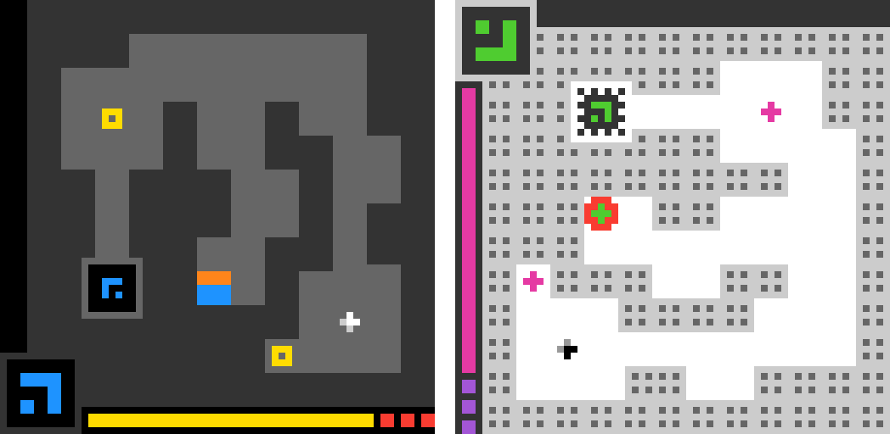

# Weight-Space Programming on Unseen Games (ARC-AGI-3)

Code and compact result data for the paper *Compiling Known Rules into Compact Neural Agents:
Weight-Space Programming on Unseen Games*.

Language-model "writers" read a game's mechanics as source code and then write either all
weights of a fixed 57,289-parameter recurrent convolutional actor, a free-architecture (FA)
network in a small static tensor-op language together with all of its weights, or an ordinary
Python player. The resulting players are evaluated on held-out levels, renderings and perturbed
starts of 20 privately authored game families and of the 25 public
ARC-AGI-3 games (`official.<id>`).

<p align="center">
  
</p>

*One state of the public game `ls20` as published (left) and under a template constructed for
illustration (right, `scripts/fig_template_example.py`). The board and HUD are turned, objects are
drawn in other styles and colours are permuted, while the mechanics stay the same. The held-out
renderings of the private families vary in this way.*

## Quick start

```bash
pip install numpy
python scripts/analyze_from_data.py --check   # recomputes the headline numbers from data/

pip install -e ".[test]"
python -m pytest tests                        # harness tests
```

The model-written players of the public tier are in `artifacts/public/`. To run one on its game,
see [Re-scoring a released public artifact](#re-scoring-a-released-public-artifact).

## Repository layout

| Path | Contents |
|---|---|
| `wsp/envs.py` | Observation-only episodes, scoring, continuous level entry, attempt detection |
| `wsp/actor.py` | Fixed 57,289-parameter actor (PyTorch) and its NumPy reference |
| `wsp/freearch.py`, `wsp/_sandbox_runner_fa.py` | Free-architecture graph language: validation, budgets (params, MACs, node evaluations), NumPy and PyTorch executors |
| `wsp/sandbox.py`, `wsp/_sandbox_runner.py` | AST audit and isolated execution of writer code (`build`, `edit`, `act`) |
| `wsp/pbounded.py`, `wsp/_pb_runtime.py`, `wsp/_sandbox_runner_pb.py`, `wsp/prompts_pb.py` | Bounded program player (condition `pbounded`): a NumPy `act()` program under the free-architecture computation model (static AST rules, counted NumPy runtime with the FA budgets, sandboxed build and one player process per episode), its prompt and feedback |
| `wsp/writer.py` | Writer client (OpenAI Responses API in background mode; Anthropic Messages API, streaming) with an append-only request ledger |
| `wsp/prompts.py`, `wsp/prompts_fa.py` | Model-agnostic prompt templates and feedback messages |
| `wsp/session.py` | One-shot and feedback writer sessions, materialisation and evaluation of artifacts |
| `wsp/queries.py`, `wsp/queries_public.py` | Support/query set construction (reviewed starts, planner-certified perturbed starts) |
| `wsp/redact2.py`, `wsp/redact2_overrides.py` | Mechanics-only redaction of the private game sources (generic machinery; per-family overrides are private, see below) |
| `wsp/redact_public.py`, `wsp/redact_public_configs.py`, `wsp/public.py` | Public tier: per-game redaction configs, game construction, level entry, attempt detection |
| `wsp/public_games.py` | Public tier without the game-collection package: builds an official game from its game file and `arcengine` (see "Re-scoring a released public artifact") |
| `wsp/public_scope.py` | Guard of the public-tier analyses (`scripts/analyze_rev2.py`, `scripts/analyze_fa_all.py`, `scripts/tables_rev2.py`): they stop unless every public arm has all its sessions evaluated for all 25 games |
| `wsp/train_bc.py`, `wsp/train_ppo.py`, `wsp/augment.py` | Learned baselines in the same actor: DAgger/BC (planner or player teacher), PPO, licensed augmentations; the DAgger learners recompute the memory under augmentation (`aug_memory`) and can also train a writer's FA graph with re-initialised weights (learned FA students) |
| `wsp/private.py` | Loader for private per-family material (not part of this release) |
| `wsp/toy.py` | `toy_reach`, an instrumentation-only game used by the tests |
| `scripts/run_rev2.py`, `scripts/run_public.py`, `scripts/run_freearch.py`, `scripts/run_pbounded.py` | Writer-session drivers (private tier, public tier, free architecture, bounded program player) |
| `scripts/eval_artifacts.py`, `scripts/blind_eval.py`, `scripts/diag_eval.py`, `scripts/postdiag_parallel.py` | Evaluation on the frozen query sets, blindness and closed-loop controls |
| `scripts/baselines.py`, `scripts/stage2.py`, `scripts/stage2_edit_rev2.py` | Learned baselines; Stage 2 (written init -> PPO; RL actor -> writer edit) |
| `scripts/analyze_*.py`, `scripts/weight_structure.py`, `scripts/tables_rev2.py`, `scripts/figures_rev2.py`, `scripts/mechanism_rev2.py`, `scripts/latency_rev2.py` | Analyses, paper tables and figures (they read the full runs directory) |
| `scripts/prespec_extra.py`, `scripts/sensitivity_prelim.py`, `scripts/perturbation_rev2.py`, `scripts/fragility_rev2.py`, `scripts/flag_summary.py` | Protocol-specified secondary analyses, sensitivity without the preliminary-study families, weight-perturbation and fragility controls (noise on all or nonzero entries, FA networks, logit margins and tie-break), sandbox-flag summary |
| `wsp/robust.py`, `scripts/run_robust.py`, `scripts/eval_robust.py`, `scripts/analyze_stage2_robust.py`, `scripts/matched_robust.py` | Robust written weights: W2 sessions whose actor must keep its behaviour under weight noise of $10^{-3}$ per-tensor RMS, their noise curves against the standard W2 runs, standard PPO from robust and standard weights (the run grid is in the docstring of `analyze_stage2_robust.py`), and the random update matched to PPO's first update |
| `scripts/fig_template_example.py` | The template example of Figure 1 on the public game `ls20` |
| `scripts/check_redaction.py`, `scripts/check_redaction_public.py` | Mechanical and functional checks of the redacted game sections |
| `scripts/rebuild_public_prompts.py` | Restores the full public-game prompts from the official game files and checks them against the frozen hashes |
| `scripts/analyze_from_data.py` | Recomputes the headline numbers from `data/` alone |
| `scripts/` (other) | Manifest and game-section builders, freeze scripts, numerical-agreement and smoke tests, utilities |
| `docs/protocol_excerpt.md` | Excerpt of the study protocol (design, conditions, hypotheses H1–H4, analysis plan) with its dated amendments |
| `tests/` | Unit tests (see "Tests") |
| `manifests/rev2/freeze*.json` | Freeze manifests: SHA-256 hashes of code, prompts, game sections and query manifests, recorded before any writer call |
| `manifests/rev2/queries_official.<id>.json` | Frozen query manifests of the public tier (episode specs, hashed) |
| `manifests/public/` | Frozen level-entry routes of the public games (`official_routes.json`: per game the winning action sequence of every level, `n_levels` and the game file's SHA-256) and `lives_map.json` (per game, how a lost life is detected), from the public-game survey |
| `data/` | Compact result data (see "Result data") |
| `artifacts/public/` | Final writer artifacts (W2, P2, FA W2 programs) and prompts of the public games (game source replaced by a placeholder), with an index (see its README) |
| `writer_config.example.json` | Optional writer configuration (shows the default endpoints and model ids) |
| `LICENSE` | Apache License 2.0 |

## Requirements

* Python >= 3.12.
* `pip install -e .` installs the harness with NumPy and PyTorch. Extras: `.[writer]` (the
  `anthropic` SDK for the Messages API client; the Responses API client uses only the standard
  library), `.[public]` (`arcengine`, the engine of the official ARC-AGI-3 games), `.[analysis]`
  (matplotlib), `.[test]` (pytest).
* `data/` and `scripts/analyze_from_data.py` need only NumPy.
* Building games, certifying starts and running or evaluating sessions use a game-collection
  package, `arc3_games` (the authors' game and planner package), which is **not part of this
  release** because it contains the private families. The harness imports it lazily, so all
  modules above except `wsp.redact2` import without it. Re-scoring the public tier does not need
  it (see "Re-scoring a released public artifact"). The interface the harness
  uses: `api.make_game(game_id, seed=, roots=)` (an environment with `step(action, row, col) ->
  (grid, state, level, changed, solved)`, `observe()`, `available_actions`, `level`, `state`,
  `n_levels`, and `engine` for official games), `api.evaluate_state(game, time_budget_ms=)` (a
  planner result with `direct_plan`), `api.make_planner`, `games.base.attempt_marker` /
  `attempt_ended`, and `sources.source_root("official", cache_dir=)`.
* **Public ARC-AGI-3 games.** `wsp/public.py` loads the official game files
  (`<id>/<version>/<id>.py`, as published by the ARC Prize Foundation) from `$WSP_OFFICIAL_ROOT`,
  else from the game package's pinned, content-addressed cache
  `<cache>/sources/official/<digest>/`, where `<cache>` is `$ARC3_GAMES_CACHE_DIR` (default
  `<runs>/private/arc3_cache`). Each game file's SHA-256 is recorded in
  `manifests/public/official_routes.json` and as `env.source_sha256` in
  `manifests/rev2/queries_official.<id>.json`, and is checked before the game is built. The engine runs with
  `ONLY_RESET_LEVELS=true` (set by `wsp.public`), so `RESET` restarts the current level. Levels are entered by
  continuous play of the frozen winning routes of the public-game survey
  (`manifests/public/official_routes.json`, plus `lives_map.json` for the attempt detector;
  `$WSP_PUBLIC_SURVEY` names another directory). The public tier comprises all 25 games of the survey.

## What is not included

* **The 20 private game families**: their simulator sources, sprites, level
  data, solvers and planners, and the game-collection package that contains them. They are kept
  private so that they remain unseen by future models.
* **Their query manifests** (`manifests/rev2/queries_<family>.json`). Their hashes are in the freeze
  manifests.
* **Private per-family material in the code.** The redaction overrides of
  `wsp/redact2_overrides.py` (regex substitutions that quote the private sources), the engine-hook
  adapters, family-specific allowlist entries and attribute names of `scripts/check_redaction.py`,
  the component descriptions of
  `scripts/mechanism_rev2.py`, the per-family dihedral-augmentation verdicts of `wsp/augment.py`
  and the renderer-template counts used by `scripts/analyze_rev2.py` (facts about the private
  games) were replaced by a loader (`wsp/private.py`). It reads them
  from a private Python module named by `$WSP_PRIVATE_REDACTION`; without it these tables are
  empty and only the generic machinery runs. With the as-run module the redacted game sections are
  byte-identical to those used in the study.
* **Writer outputs and run outputs**: prompts (they contain the game sections), responses and
  transcripts, written programs and weights, trained students, episode traces, the request ledger
  and everything else in the runs directory, except the compact summaries in `data/` and, for the
  public games only, the final programs of the feedback sessions and the prompts in `artifacts/public/`.
  The game sections are not redistributed: the official game source in each released prompt is
  replaced by a placeholder, and `scripts/rebuild_public_prompts.py` rebuilds it from the official game
  files and checks the full prompt against its frozen hash.
* **The official ARC-AGI-3 game files.** Download them from the official source (see "Re-scoring a
  released public artifact").

## Result data (`data/`)

Compact summaries of the study's run outputs; `data/export_info.json` records
the export time, run tags and counts. The public tier has no BC-oracle runs.

| File | Contents |
|---|---|
| `sessions.csv` | One row per writer session in the run tags `rev2_private` (main private-tier grid), `rev2_c3` (ablations: information MS, actor variants, P-react, effort), `rev2_fa` (free architecture, private), `rev2_public`, `rev2_fa_public`, `rev2_fa_fixedgraph`, `rev2_fa_fixedops` (FA language controls), `rev2_private_weak`, `rev2_fa_weak` (weaker and anchor writers, fixed actor W2 and FA), `rev2_pbounded` (bounded program player, private tier, the four frontier writers, feedback) |
| `baselines.csv` | Learned baselines, one row per family/method/student/seed: `bc_support`, `bc_aug`, `bc_aug_dihedral`, `bc_oracle` (capacity ceiling, trained on all levels), `ppo`, `ppo_shaped`, `distill_aug`, `distill_plain` (writer-player teacher with and without augmentation; `teacher_writer`, `teacher_run`); columns below |
| `stage2_rl.csv` | Stage 2, written initialisation -> PPO, one row per family/init writer/variant/reward/seed (`theta0` = PPO from the random initialisation of the learned baselines, `rlcont` = PPO continued from an RL-trained actor) |
| `stage2_edit.csv` | Stage 2, RL actor -> writer edit (`summary` / `inspect` arms) |
| `analysis/analysis_rev2*/*.json` | The analysis outputs the paper tables are built from (`scripts/analyze_rev2.py`, also with `--tags rev2_private_weak` for `analysis_rev2_weak/`; `analyze_fa*.py`, `analyze_learned_fa.py` (`learned_fa.json`), `analyze_pbounded.py` (`pbounded.json`), `weight_structure.py` (`weight_structure.json`), `analyze_stage2_rev2.py`, `mechanism_rev2.py`, `perturbation_rev2.py`, `fragility_rev2.py`, `flag_summary.py`, and for the robust-weights condition `eval_robust.py` (`robust.json`), `analyze_stage2_robust.py` (`stage2_robust.json`) and `matched_robust.py` (`matched_robust.json`)), with run paths relative to the runs directory. `request_accounting.json` holds the request and session accounting behind the paper's request and missingness tables: per arm, per writer and in total, the requests by outcome (completed, truncated, refused, API error, interrupted), the re-run sessions, the sessions without an artifact and the tokens; requests outside the main study (prompt pilots, smoke tests and the preliminary study) are one aggregate count. In `mechanism.json` the component names, claims and predictions in prose are withheld and the component ids are neutral; the numeric predictions, checks and results are complete |
| `latency_summary.json` | Deployment-cost measurement (params, MACs, node evaluations, latency per artifact kind) |

Columns of `sessions.csv`: `tag`, `tier` (`private`/`public`), `family`, `writer` (short labels:
`astra-6` = GPT-6 Astra, `sol-6.1` = GPT-6.1 Sol, `opus-5.5` = Claude Opus 5.5, `terra-6.1` =
GPT-6.1 Terra, `luna-6`, `sonnet-5.5`, `haiku-5.5`, and the anchors `sol-5.6`, `opus-5`),
`condition` (`weights`, `python`, `pyreact`, `freearch`, `pbounded`), `mode` (`oneshot` = W1/P1, `feedback` =
W2/P2), `info` (`M` mechanics only, `MS` mechanics + solver), `variant` (actor variant: `full`,
`noaxial`, `t8`), `effort`, `run`, `rounds_used`, `final_round` (round of the delivered artifact),
`delivered`, `outcome` (`artifact`; or, all scored 0: `invalid_artifact`, `writer_refusal` for a
usage-policy stop, `writer_incomplete` for a reply cut at the output cap, and `writer_error` or
`writer_unknown` for a request that failed or ended without a result), `support_solved`/`support_n`/`support_success` (the delivered artifact on
the support episodes), `evaluated`, `q_lvl_level_balanced` (the headline metric: mean over
held-out levels of per-level success on Q-lvl; 0 if no artifact was delivered), `rate_<set>`
(raw episode solve rate per evaluation set: `S-start`, `Q-lvl`, `Q-tpl`, `Q-off`, `Q-pal`), and
`tokens_in`, `tokens_out`, for FA `fa_params`, `fa_macs_per_step`, `fa_node_evals_per_step`, and for the
bounded player `pb_constants`, `pb_ops_per_call`, `pb_work_per_call` (budget use of the delivered program:
constants, operations and element operations per call).
Evaluation sets: S-start/S-dev = support starts (seen levels and renderers), Q-lvl = held-out
levels, Q-tpl = held-out renderer templates, Q-off = perturbed starts on support levels, Q-pal =
palette permutations. `rate_Q-tpl` is the raw rate over all Q-tpl episodes; the paper's Q-tpl
counts only renderers never shown in support.

Columns of `baselines.csv`: `tier`, `family`, `method`, `student`, `seed`, `variant`
(`trunc`: the evaluated last checkpoint of a truncated PPO run), `teacher_writer`, `teacher_run`,
`student_saved`, `evaluated`, `q_lvl_level_balanced`, `rate_<set>` (as in `sessions.csv`), and
`student_graph`, `time_cap_h`, `truncated` for the learned FA students.
`student`: `fixed_actor`, or `writer_fa_graph` for the learned FA students, where the FA
graph of the family's GPT-6 Astra FA W2 run 0 (`student_graph`, relative to the runs directory) is
trained from re-initialised weights by BC-support or by distillation of the same writer's run-0 P2
player without augmentation, with a 6-hour wall-clock cap (`truncated` if it was reached). A learned FA
student with `student_saved` False stopped because its weights became non-finite (it diverged); the
paper scores it 0. For the other learners, `student_saved` only records whether the trained weights
were kept.

## Reproduction

### Analysis from `data/`

```bash
pip install numpy
python scripts/analyze_from_data.py --check
```

This recomputes the main table (family-macro level-balanced Q-lvl per writer and arm), the free
architecture vs fixed actor comparison with its paired family bootstrap, the learned baselines,
the learned FA students, the Stage-2 summary and the bounded program player
vs FA W2, fixed W2 and P2 (paired family bootstrap, delivery, strata), and with `--check`
compares them (means, differences and bootstrap intervals) with the shipped analysis outputs.
The table and figure scripts (`scripts/tables_rev2.py`, `scripts/figures_rev2.py`) and the
analysis scripts read the full runs directory, which is not released.

### Re-scoring a released public artifact

Needs `pip install -e ".[public]"` (adds `arcengine` 0.9.3) and the official game files at the
versions of the study, but not the game-collection package. The ARC-AGI-3 API serves them (the
ARC-AGI-3 toolkit `arc-agi` downloads them into the same layout, `environment_files/<id>/<version>/<id>.py`):

```bash
KEY=$(curl -s https://three.arcprize.org/api/games/anonkey | python -c "import json,sys; print(json.load(sys.stdin)['api_key'])")
for g in ar25-0c556536 bp35-0a0ad940 cd82-fb555c5d cn04-2fe56bfb dc22-fdcac232 ft09-0d8bbf25 g50t-5849a774 \
         ka59-38d34dbb lf52-271a04aa lp85-305b61c3 ls20-9607627b m0r0-492f87ba r11l-495a7899 re86-8af5384d \
         s5i5-18d95033 sb26-7fbdac44 sc25-635fd71a sk48-d8078629 sp80-589a99af su15-1944f8ab tn36-ef4dde99 \
         tr87-cd924810 tu93-0768757b vc33-5430563c wa30-ee6fef47; do
  d=official/${g%-*}/${g#*-}; mkdir -p $d
  curl -s -H "X-Api-Key: $KEY" -o $d/${g%-*}.py https://three.arcprize.org/api/games/$g/source
done
export WSP_OFFICIAL_ROOT=$PWD/official
python scripts/eval_artifacts.py artifacts/public/official.ls20/astra-6/w2_r0.py --device cpu --batch 1 --out eval_out
```

`eval_out/official.ls20/astra-6/w2_r0/eval.json` holds the solve rate of each set, every episode
and `q_lvl_level_balanced`, to compare with `artifacts/public/index.csv`. A directory argument (e.g.
`artifacts/public/official.ls20`) re-scores every artifact below it. Each game file is checked
against its SHA-256 in `manifests/public/official_routes.json` before it runs (all 25 matched the
files the API served on 8 November 2026). Without the game package, `wsp.public` builds the games with
`wsp/public_games.py`, which steps identically to the package's environment (checked over all 25
frozen routes plus 60 random actions per level, 16,796 steps). Without CUDA use `--device cpu --batch 1`
(see "Numerics" in `artifacts/public/README.md`). Re-scored this way, `official.ls20/astra-6/w2_r0.py`,
`official.ls20/opus-5.5/p2_r1.py` and `official.cd82/terra-6.1/fa_w2_r0.py` reproduce every S-start,
Q-lvl and Q-off episode of the study (outcome and number of actions). For `official.ls20/astra-6/w2_r1.py`
every outcome and rate matches, but 33 of 91 episodes take a different number of actions, also with the
game package on CPU (CPU instead of CUDA rounding).

### Writer configuration

The clients use the vendors' public endpoints and model ids (`MODELS` in `wsp/writer.py`) and read
the keys from the environment:

| Variable | Meaning |
|---|---|
| `OPENAI_API_KEY` | Key for the OpenAI Responses API (GPT writers; background mode: create, poll, cancel) |
| `ANTHROPIC_API_KEY` | Key for the Anthropic Messages API (Claude writers; streaming) |
| `WSP_RESPONSES_BASE_URL`, `WSP_ANTHROPIC_BASE_URL` | Optional: another base URL |
| `WSP_MODEL_ID_<KEY>` | Optional: another model id for a writer, e.g. `WSP_MODEL_ID_ASTRA_6` |

The optional settings can also be given in a copy of `writer_config.example.json`, saved as
`writer_config.local.json` or named by `$WSP_WRITER_CONFIG`.

Every request is first written to an append-only ledger (`<runs>/ledger.jsonl`). A request whose
fate is unknown is never resubmitted automatically. Settings used in the paper: effort `high`, up to
128k output tokens, a 90-minute wall limit per request, and a 96k advisory task budget for the
Claude writers (set in `scripts/run_rev2.py`).

### Writer sessions on a public game

With the game-collection package installed and the official game files in its cache (see "Requirements"):

```bash
export WSP_RUNS=/path/to/runs      # outputs go here (default: ../runs next to this repository)
python scripts/run_public.py --games ls20 --models astra-6 --conds weights:feedback --runs 1 --dry   # build prompts only
python scripts/run_public.py --games ls20 --models astra-6 --conds weights:feedback,python:feedback --runs 1
python scripts/run_freearch.py --tag rev2_fa_public --families official.ls20 --models astra-6 --conds freearch:feedback --runs 1
python scripts/eval_artifacts.py "$WSP_RUNS/rev2_public"       # writes eval.json per session
```

Session directories are `<runs>/<tag>/<family>/<writer>/<condition>_<mode>_<info>[_<variant>]_r<k>/`.
Re-running sessions creates new, independent samples; they will not reproduce the paper's
artifacts exactly.

### Exact FP32 evaluation

Evaluate written actors in exact FP32 with TF32 disabled. Written actors have high-gain weights,
and TF32 convolutions and matrix products flip their argmax decisions.
`scripts/eval_artifacts.py`, `scripts/postdiag_parallel.py` and `wsp.freearch` set

```python
torch.backends.cuda.matmul.allow_tf32 = False
torch.backends.cudnn.allow_tf32 = False
```

and any other evaluation should do the same.

### Tests

```bash
python -m pytest tests
```

Without the game-collection package, the tests of the actor, the free-architecture language and
executors (including the learned FA students' executor and initialisation), the sandbox, the
bounded program player (static rules, runtime guards, budgets, equivalence with an FA network on toy and
random frames), the augmentations and the training utilities that need no game run and pass. Tests that build other games than the public ones (including the `toy_reach` tests, which use the package's generic
attempt detector and planner interface) need the package; tests on private families also need
the private games. `tests/test_public.py` checks the released routes and lives map against the query
manifests; its game tests run when the official game files are available (`$WSP_OFFICIAL_ROOT` or the
package's cache), with or without the package; its comparison of `wsp/public_games.py` with the package's
environment needs both.

### Environment variables

| Variable | Default | Meaning |
|---|---|---|
| `WSP_RUNS` | `../runs` next to the repository | Runs directory (outputs, ledger) |
| `WSP_PRIVATE_MANIFESTS` | unset | Directory with the private families' query manifests (same layout as `manifests/`) |
| `WSP_PRIVATE_REDACTION` | unset | Private module with the per-family redaction material (`wsp/private.py`) |
| `WSP_OFFICIAL_ROOT` | unset | Directory with the official game files, `<id>/<version>/<id>.py` (takes precedence over the cache) |
| `ARC3_GAMES_CACHE_DIR` | `<runs>/private/arc3_cache` | Game package's pinned cache of the official game files |
| `WSP_PUBLIC_SURVEY` | `manifests/public` | Frozen public routes and lives map |
| `WSP_WRITER_CONFIG` | `writer_config.local.json` | Optional writer configuration file |
| `WSP_NO_TF32` | unset | If set, `scripts/stage2.py` trains in exact FP32 (the exact-FP32 PPO runs) |

## Integrity

Prompts, game sections and evaluation sets were frozen and hashed before the first writer call of
each arm (`manifests/rev2/freeze*.json`): the main study (`freeze.json`), the public tier
(`freeze_public.json` for 24 games and `freeze_public_ka59.json` for `official.ka59`), the free
architecture (`freeze_fa.json`, `freeze_fa_6fam.json`), its language controls
(`freeze_fa_controls.json`) and the bounded program player (`freeze_pbounded.json`). Each manifest
holds the SHA-256 of the prompts and, where applicable, the game sections and query manifests of its
arm, and of the code files at that point. `freeze_public_ka59.json` is an excerpt (hashes only; see its `excerpt` field).

The prompt and section hashes of the public tier can be checked with
`scripts/rebuild_public_prompts.py`; those of the private tier need the private game sections. A
code file differs from its frozen hash where it was extended for a later arm or analysis, or where
private per-family material was moved to `wsp/private.py` and the game package is imported lazily.

## License

Apache License 2.0; see `LICENSE`. The `arcengine` excerpts quoted in the prompts in
`artifacts/public/<game>/prompts/` are third-party code and keep their original terms; the official
game files are not redistributed (download them as described under "Re-scoring a released public artifact").
